# 👋 Hi, I'm Taj!

### 🌙 Late-Night Code Whisperer & Full-Stack Product Engineer
*Architecting scalable multi-tenant systems, developer tools, and elegant apps with **Laravel**, **React**, **TypeScript**, and **Node.js** since 2020.*

---

## 🚩 About Me

I build software that feels effortless on the surface and stays rock-solid under load. From multi-tenant SaaS architectures to framework-agnostic open-source SDKs, I care deeply about clean boundaries, developer ergonomics, and shipping products that scale.

- 🎯 **Core Focus:** Clean architecture, scalable multi-tenant systems, and high-craft user experiences
- 🧠 **Engineering Mindset:** Lifelong builder exploring distributed systems, agentic AI workflows, and open-source tooling
- 🤝 **Collaboration:** Open to technical partnerships, high-impact product engineering, and open-source quests

> *"Clean architecture is about intent: your system should scream what it does."*  
> — **Robert C. Martin (Uncle Bob)**

---

## 🤝 Open Source & Featured Work

### 🎬 [Interactive Video Labs](https://github.com/interactive-video-labs) *(Core Contributor)*
Architecting an open-source ecosystem for synchronized, cue-driven interactive video experiences across modern web frameworks:
- **`@interactive-video-labs/core`:** Framework-agnostic TypeScript player engine powering deterministic video cues and state management.
- **Framework Integrations:** First-class adapters and tooling for **React**, **Vue**, **Angular**, and **Svelte**, alongside cue detection and lesson management utilities.

### 🚀 Selected Projects

<!-- PROJECTS_START -->
<!-- Generated by .\.github\scripts\sync-readme.mjs -->
<!-- PROJECTS_END -->

---

## 🛠️ Tech Stack & Toolbox

<!-- TECH_STACK_START -->
<!-- Generated by .\.github\scripts\sync-readme.mjs -->
<!-- TECH_STACK_END -->

---

## 🌱 Currently Exploring

- 🔍 **Modern Backend & Strict Typing:** Advancing architectural patterns in **TypeScript**, **FastAPI**, and **SQLAlchemy**
- ⚙️ **Distributed Systems:** System design trade-offs, cloud-native scaling patterns, and event-driven architecture
- 🌐 **Developer Tooling:** CLI automation, open-source SDK ergonomics, and composable design systems

---

## 📊 GitHub Analytics

---

<!-- READING_LIST_START -->
<!-- Generated by .\.github\scripts\sync-readme.mjs -->
<!-- READING_LIST_END -->

---

## ⚡ Trivia & Vibe

<table>
  <tr>
    <td width="50%" valign="top">
      <h3>💡 Random Dev Fact</h3>
      <!-- RANDOM_FACT_START -->

  

<!-- RANDOM_FACT_END -->
    </td>
    <td width="50%" valign="top">
      <h3>✨ Off the Clock</h3>
      <ul>
        <li>☕ Coffee fuels late-night architecture sessions</li>
        <li>🎷 Coding playlists: Lo-fi beats & synthwave</li>
        <li>🏙️ Observing urban design, transit & places</li>
      </ul>
    </td>
  </tr>
</table>

---

### 💌 Want to team up for an open-source quest or build something great?
Connect with me on **[LinkedIn](https://www.linkedin.com/in/tajul-islam-j)**, explore my **[Portfolio](https://taj54.github.io)**, or send a carrier pigeon 🕊️

